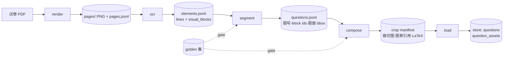

# 08 题目入库线：可重放数据流框架

状态：**草案（2026-11-03），待人批**。本文档定义把"识别复杂 PDF 试卷题目并入库"引入本仓库的框架。
合并本 PR 即视为批准四件结构事项（02 §2 要求人批）：

1. 00 §1 范围修订：新增**题目入库线**为第三条线（前两条：小讲师、评测），其余业务域仍不迁移；
2. 顶层包 6 → 7，新增 `ingest`；
3. 预算表两项收紧：应用代码总行数 30000 → 27000，配置文件 5 → 4；
4. import-linter 新增 2 条合同（§7）。

## 1. 需求与老仓库教训

需求：PDF 试卷（印刷为主、含公式/表格/几何图）→ 结构化题目记录（题干文本+LaTeX、bbox、
裁切图、图表引用）→ 幂等入库，供小讲师与评测线消费。老仓库对应物是
`question_ingestion` 生产链路 + `experiments/pdf_boundary_locator` 实验场，已随老仓库冻结维护。

老仓库此链路的失败模式（2026-11-03 调研证据：Gitee `lsc728512378/edu_agent`）：

| 病因 | 证据 |
|---|---|
| 阶段共享可变状态、实现互相 import | `configs/pdf-layer-imports.yaml`、`pdf-g3-batch-plan.yaml` 专设 import 规则与"机械搬移"批次；改一个阈值需全链回归 |
| 质量门禁散落在实验脚本 | `experiments/pdf_boundary_locator` 下 40+ 脚本各自实现 golden/ownership/presentation 检查，与生产链路两套人肉同步 |
| 模型接入面失控 | 6 种 provider、11 份 registry 配置；并发性能文档记录 300 次提交中 33 次修租约/预载/恢复 |
| 实验 replay 思想未扶正 | replay/golden 门禁只在实验场可用，生产链路无单阶段重跑能力 |

结论：症状是"牵一发而动全身"，根因是**阶段边界不 immutable、质量机制不可复用、模型接入不自收敛**。

## 2. 设计原则（四条）

1. **阶段 = 纯函数 + 不可变 artifact。** 每个阶段读上一阶段的落盘产物，写自己的产物目录；
   不读全局状态、不写共享数据库（`load` 除外，见 §6）。
2. **模型调用只经 gateway。** OCR/分段引擎在 `configs/models.yaml` 按角色声明，
   每引擎一个薄归一化层；引擎进程生死归 systemd/launchd（01 §2 原则原样适用）。
3. **质量规则 = 数据行，不是脚本。** golden 集与断言是声明式数据；新增质量规则只允许加数据行。
4. **v1 只做一条链。** PDF → 题目记录 → 入库。编辑器、版面重排 UI 等留在老仓库（§9）。

## 3. 阶段与 artifact 合同

| 阶段 | 输入 | 输出 | 关键失败类型（枚举，进 gateway/阶段错误契约） |
|---|---|---|---|
| render | PDF | `pages/`（固定 dpi PNG）+ `pages.jsonl` | `pdf_invalid`、`page_render_timeout` |
| ocr | pages | `elements.jsonl`：归一化 `lines` + `visual_blocks`，bbox 为像素坐标 | `ocr_timeout`、`ocr_empty`、`ocr_layout_invalid` |
| segment | elements | `questions.jsonl`：题号、target_block_ids、题面 bbox、排除的 header/栏目 block ids | `segment_empty`、`segment_boundary_invalid` |
| compose | questions + pages | crop manifest：裁切 PNG、图表引用、题干 Markdown+LaTeX | `crop_out_of_page`、`formula_missing` |
| load | manifest | store 两张表（§6） | `duplicate_question`（幂等跳过，非错误） |

规则：

- **阶段间禁止 import 相邻阶段代码**，只通过 schema 校验过的 artifact 衔接（import-linter，§7）。
- 合同 schema 放 `contracts/`（`ingest_pages_v1`、`ingest_elements_v1`、`ingest_questions_v1`、
  `ingest_crop_v1`），带 `version` 字段；不兼容变更 = 新版本号，旧版本只读兼容一个里程碑。
- **每 run 一个不可变目录** `var/ingest/<run_id>/<stage>/`。重跑任何阶段 = 指定输入 run 目录、
  写入新 run 目录；改阈值只重跑受影响阶段，上游产物直接复用——这是对老仓库"改一处全链重跑"的
  直接解法，把实验场 replay 扶正为唯一执行形态。

## 4. 模型接入：复用 gateway，一 role 一引擎

- `configs/models.yaml` 新增两个角色：`ocr_layout`（版面+文字+公式）、`question_segment`（题干边界归属）。
- 每个引擎一个归一化模块（`ingest/engines/`，每引擎硬上限 150 行）：行级 JSON、元素级
  blocks/elements、`<|det|>` 检测文本 → 统一 `lines + visual_blocks`。
- **换引擎 = models.yaml 改一行 + golden 集重跑**，对比报告自动产出（§5）。候选引擎：本地
  PP-OCR 系行级、远程文档解析引擎（SoMark OXR / baidu Unlimited-OCR，经其 OpenAI 兼容或
  HTTP 接口）。v1 最多接两个引擎；接第三个必须先删一个（防 provider 面失控重演）。
- gateway 既有中间件（timeout/retry/ratelimit/fallback/record）原样生效；`model_call` 事实记录
  覆盖 ingest 全部调用，效率口径与 01 §5 统一。

## 5. 质量闭环：golden 集是数据，门禁是唯一脚本

- golden 集进 `evals/datasets/ingest_golden/`：从老仓库搬 `golden_cases.jsonl` 断言与 3~5 份
  真实试卷（含 `8数A.pdf`、`排期末真卷3(1).pdf`；页眉/栏目污染案例 `grade8_math_a_page4_header_pollution`
  必须进 blocking 层）。
- 断言声明式：`expected_status`、`forbidden_target_text`、`forbidden_presentation_text`、
  `must_contain_formula`。**一个通用 gate runner（`ingest/gate.py`）**消费断言出报告；
  除它之外不允许存在第二个质量检查脚本（老仓库 40+ 脚本的教训）。
- 报告对照 `baselines/ingest.json` 容差判定，指标四项：`false_accepted` 率（blocking 层零容忍）、
  题干边界归属准确率、公式 LaTeX 编辑距离、单页耗时与成本。口径与评测线
  `facts → report → 容差 Gate → 判定表` 闭环一致，夜评工作流按需挂载。

## 6. 入库与幂等

- 题目记录字段：题干 Markdown+LaTeX、bbox、裁切图与图表引用路径、来源 `run_id`/页码/题号、
  学科元数据。
- 主键 = 规范化题干文本 `sha256` + 学科维度；同一 PDF 重放、重复导入均幂等（命中即跳过，
  记 `duplicate_question` 事实，不报错）。
- v1 `store` 只加两张表：`questions`、`question_assets`。agents 线经 store 读题库，
  不感知 ingest。

## 7. 预算与合同修订（本 PR 批准即生效）

| 项 | 现状 | 修订后 | 说明 |
|---|---|---|---|
| 顶层包 | 6/6（满） | **7/7**：+`ingest` | 02 §2 预算表与 `.importlinter` 登记同步改 |
| 应用代码总行数 | 30000 | **27000** | 要加就先删；ingest 线预算（≤4000 行）含在总量内 |
| 配置文件（configs/） | 5 | **4** | 引擎声明并入 models.yaml，不加新配置文件 |
| import-linter | 4 条 | **+2**：`ingest-no-api-agents-evals`、`agents-no-ingest` | ingest → gateway/store/contracts 合法；evals → ingest 合法（golden 门禁）；agents 不感知 ingest |
| 依赖 | 6/15 | 不变 | render 用 pymupdf 等按需计入，先删后加 |

ingest 内部登记项（budget.py 只报告）：`ingest-total-lines ≤ 4000`、`engines ≤ 2`、
`gate runner = 1`。

## 8. 里程碑

| 阶段 | 交付 | 验收 |
|---|---|---|
| ING-1 | contracts schema ×4；render/ocr/segment 纯函数；golden 集与 gate runner；双引擎对比报告 | golden 容差报告产出；不接 store、不开 API |
| ING-2 | compose + load 幂等入库；`baselines/ingest.json` 冻结 | 同一 PDF 重放结果幂等；夜评挂载 |
| ING-3（另立文档） | 题目记录对外接口、api 包接入 | 届时评估，不在本 PR 承诺 |

## 9. v1 非目标

题目编辑器、版面重排 UI、作文/试卷批改与微课业务域、蓝绿发布、多租户与可见性策略、
feature flag、第三个以上 OCR 引擎、OCR 结果人工复核工作流。以上留在老仓库冻结维护。

## 10. 校验源

- §3 合同 → `contracts/` schema（ING-1 落地后生效）
- §7 数字 → `scripts/budget.py` 与 `.importlinter`
- §1 老仓库证据 → Gitee `lsc728512378/edu_agent`：`edu_agent/app/question_ingestion/`、
  `experiments/pdf_boundary_locator/`、`design/调研与实验/题目内容处理研究/`
